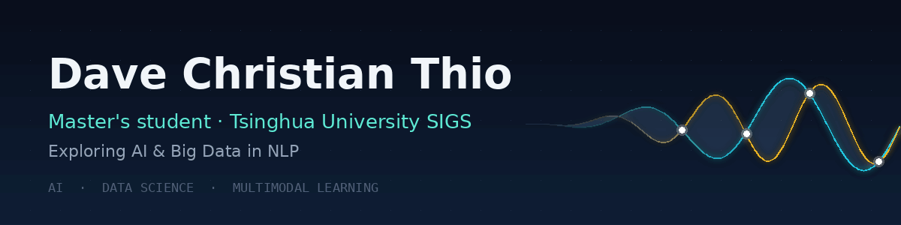

<picture>
  <source media="(prefers-reduced-motion: reduce)" srcset="profile-banner.png">
  
</picture>

 

**Master's student at Tsinghua University**  
[Tsinghua Shenzhen International Graduate School (Tsinghua SIGS)](https://www.sigs.tsinghua.edu.cn/en/7382/list.htm)

I'm interested in AI, data science, and how we can learn from human signals—from facial expressions to the way we speak.

**Exploring** &nbsp; `Artificial intelligence` · `Data science` · `Multimodal learning`

---

### Featured project

#### [Multimodal Emotion Analysis ↗](https://github.com/davethio/RAVDESS-Multimodal-Emotion-Analysis)

**What do a face and a voice tell us together?**

Investigating where facial cues and speech prosody overlap—and where they offer complementary information—in emotional communication, using RAVDESS.

[Explore the project →](https://github.com/davethio/RAVDESS-Multimodal-Emotion-Analysis)

---

### Let's connect

[LinkedIn](https://www.linkedin.com/in/davecthio/) &nbsp; / &nbsp; [ORCID](https://orcid.org/0009-0005-4394-9675) &nbsp; / &nbsp; [Instagram](https://www.instagram.com/davecthio/) &nbsp; / &nbsp; [TikTok](https://www.tiktok.com/@davecthio)

Outside the code, I also create content on Instagram and TikTok.
